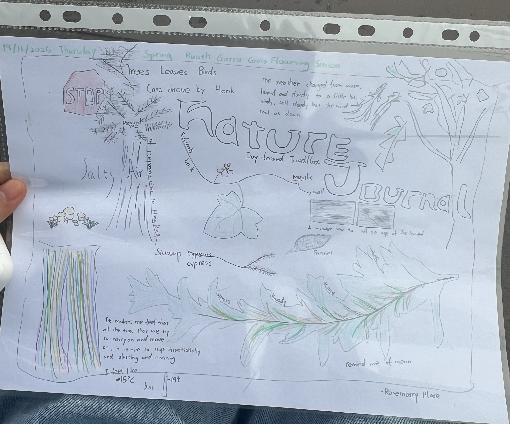
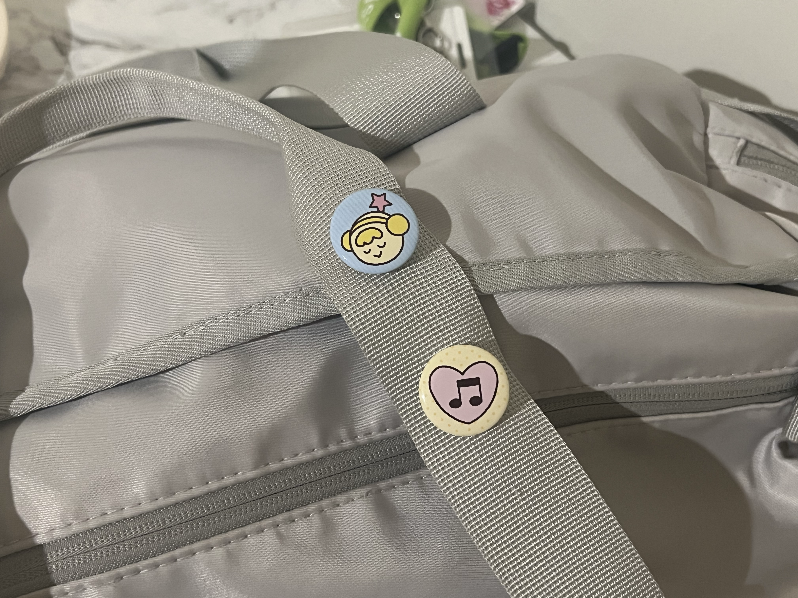

---

layout: post

title: "Written in Passages Cafe"

date: 2026-11-22 15:05:00 +1000

categories: update blog

---

### Nature Journaling

This Thursday, I signed up for a nature journaling event in the Melbourne CBD. I didn't quite know what nature journaling was, but its key components — drawing and plants — really attracted me. So I rocked up without much expectation, or rather, without knowing what to expect. I love moments like this, don't know what's next but know that I am feeling safe enough to step out and try.

But it turned out to be wonderful. Although the weather was a bit dull and cloudy, intentionally opening up your senses to feel and see what's around you is really stress-relieving. I would definitely do that again when I get the time.

Below is my little drawing piece :) It actually reminded me of the homework we were assigned in elementary school, where we were asked to draw things for events like Plant Day. I always enjoyed observing the world from my own perspective.

The nature journaling lead is a woman named Kathleen, and I love her energy. As we approached the end of the session, the group of us started chatting about random topics. One of the things we talked about was how Kathleen signs off her emails.

She told us that every time she finishes writing an email, she stops and looks out the window to see what she can observe. Then, she adds a little sentence at the end of her email describing something small, like the weather that day or where she is.

I think this is such a great thing to do. It makes me wonder what other little things we can do to help us feel more present and more human.

Most of the days we let the "work" interrupt us and pays all of our attentions to it, sometimes we need to let the world interrupts us.

- Nature Journaling
    

### HO HO HO 🎄

The company I work for officially put up the Christmas tree last Friday! Lowkey it might got put up because Microsoft outlook was down and people are liberated from emails. And I helped a little. It's my first time putting up a Christmas tree, and it was a bit more work than I thought. Did you know that Christmas trees don't come in a box, automatically stand up, and move to where they need to be? How rude?

### Handcraft Market

To get work out of my mind, going to a handcraft market was a successful attempt! Melbourne has so many markets that I feel like I miss at least 100 of them every year, but this time, I caught one just in time.

There was just so much cute stuff!!! I bought some things to decorate my bags hehe.

- Bag decorations
    

### Bell Rings for Next Year

As I am writing this, there are only a couple of weeks left until 2027. The year spins and spins like an unstoppable coin, and I get caught up in between, trying to find a place to breathe and rest.

I've met a lot of new people on this new journey, and I'm grateful for so many of these relationships. There are also some that I've summoned up the courage to walk away from.

I also have a big surgery coming up in early December, and I'm trying my best to prepare for it. I hope everything is going to be fine, just like I always know it always will be.

⭐ © 2026 Wingyee | Written at Passages Cafe, Melbourne. Ordered an iced mocha. Outside, little raindrops are falling,
but it's not quite rainy. The air is humid and warm.
